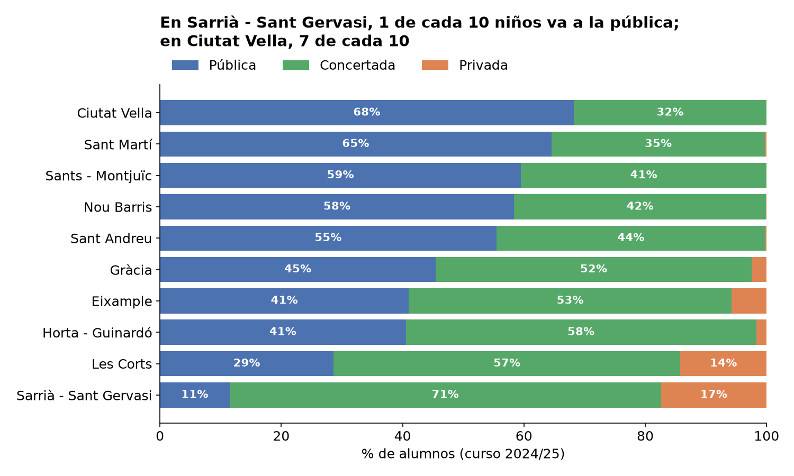
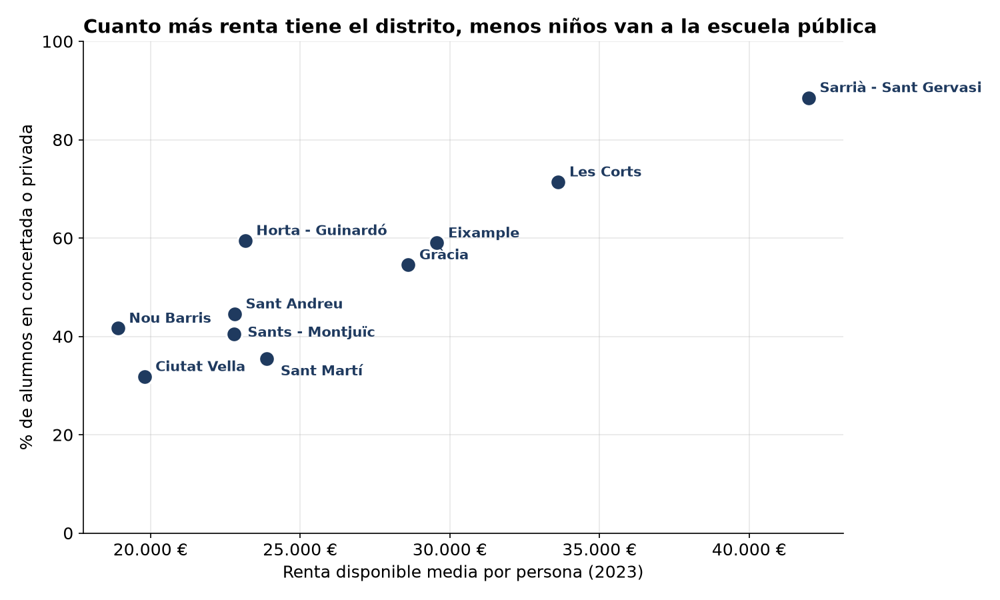
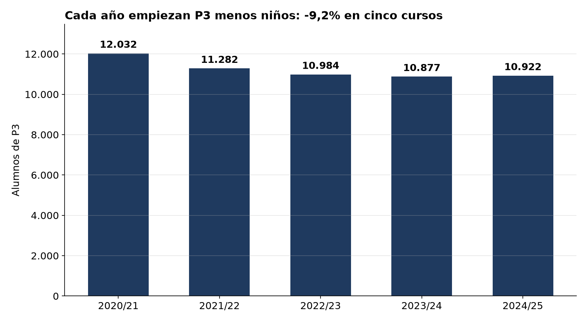

# Informe ejecutivo: ¿Dónde estudian los niños de Barcelona?

**Alcance:** alumnos de 3 a 16 años (Infantil P3-P5, Primaria y ESO) · cursos 2020/21 – 2024/25
**Fuentes:** Generalitat de Catalunya (matrícula por centro) y Ajuntament de Barcelona (renta por distrito)

---

## En 30 segundos

1. **Uno de cada dos niños de Barcelona estudia en la escuela concertada** (50,8%). La pública escolariza al 43,8% y la privada sin concierto al 5,3%.
2. **El distrito lo cambia todo, y va unido a la renta.** En Sarrià - Sant Gervasi solo 1 de cada 10 niños va a la pública; en Ciutat Vella, 7 de cada 10.
3. **Cada año empiezan la escuela menos niños** (-9% en P3 en cinco cursos), y la pública es la que más alumnos pierde.

---

## Hallazgos clave

### 1. La concertada es la opción mayoritaria
En el curso 2024/25 hay **177.593 alumnos** de 3 a 16 años. La mitad va a la concertada. Esta proporción es casi igual en los cinco cursos analizados: no es algo puntual, es la estructura de la ciudad.

### 2. Dónde vives decide a qué escuela vas

La privada sin concierto casi solo existe en dos distritos: Sarrià - Sant Gervasi (17%) y Les Corts (14%). **La mitad de los centros privados** de la ciudad están en estos dos distritos.

### 3. Más renta, menos escuela pública

La relación es **muy fuerte**: en Nou Barris, el distrito con menos renta, el 41,7% de los alumnos va a la concertada o la privada; en Sarrià - Sant Gervasi, el de más renta, el 88,5%. Excepción: **Horta - Guinardó** tiene mucha concertada (58%) sin ser un distrito rico.

### 4. La concertada no tiene clases más pequeñas
Solo la **privada** tiene grupos claramente más reducidos (12-13 alumnos en Infantil y Primaria). En la **concertada**, las clases son **iguales o un poco más grandes** que en la pública, y en ESO llegan a 30 alumnos, el máximo legal.

### 5. Casi 2 de cada 3 alumnos de la concertada van a un centro de origen religioso
Los titulares de la concertada son sobre todo **fundaciones** (42%) y **órdenes religiosas** (34%). Muchas fundaciones son también religiosas (Jesuïtes, Maristes, Escolàpies...). En total, estimamos que alrededor del **64%** de los alumnos de la concertada estudia en un centro de origen religioso.

### 6. Menos niños en P3, sobre todo en la pública

En cinco cursos, P3 pierde **1.110 alumnos** (-9,2%). La pública baja un **11,1%** y la concertada un **8,1%**. Esta generación más pequeña llegará a Primaria y a la ESO en los próximos años.

### 7. Al llegar a la ESO, la concertada gana peso
La concertada escolariza al 46% de los alumnos en Infantil, al 48% en Primaria y al **57% en ESO**. Una razón probable: el **84%** de los centros concertados con Primaria sigue hasta la ESO; en la pública, solo el **13%**. En la pública, la mayoría de las familias tiene que cambiar de centro a los 12 años, y en ese momento algunas eligen la concertada.

---

## Recomendaciones

1. **Planificar las plazas de Infantil con la caída de P3.** Habrá menos alumnos en todas las etapas en los próximos años. Es una oportunidad para **bajar el número de alumnos por clase** en lugar de cerrar grupos.
2. **Facilitar el paso de Primaria a ESO en la pública.** Más *institut escola* (centros de 3 a 16 años) o itinerarios claros entre escuela e instituto pueden reducir la salida de alumnos hacia la concertada a los 12 años.
3. **Mirar la oferta pública por distrito.** En Sarrià - Sant Gervasi y Les Corts la escuela pública es minoritaria. Antes de decidir, conviene estudiar si las familias eligen la concertada o si **no encuentran plaza pública** cerca de casa (datos de preinscripción).

---

## Límites del análisis

- La renta es la **media del distrito**, no la de cada familia: hablamos de zonas, no de decisiones individuales.
- Solo hay **10 distritos**: las relaciones fuertes son claras, pero no podemos hablar de causa y efecto.
- La caída de P3 encaja con la bajada de la natalidad, pero **no tenemos datos de natalidad** en el análisis.
- El 64% de origen religioso es una **estimación** basada en el nombre de los titulares.

---

**Más detalle:** análisis completo en el [notebook](../notebooks/01_eda_educacion_bcn.ipynb), calidad de los datos en [calidad_datos.md](calidad_datos.md) y exploración interactiva en el dashboard *(enlace pendiente del despliegue)*.
